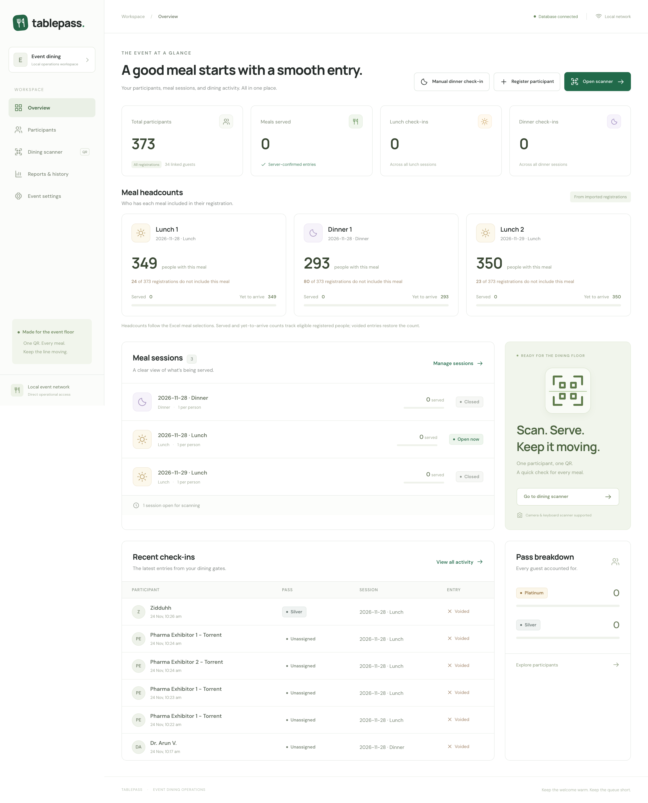
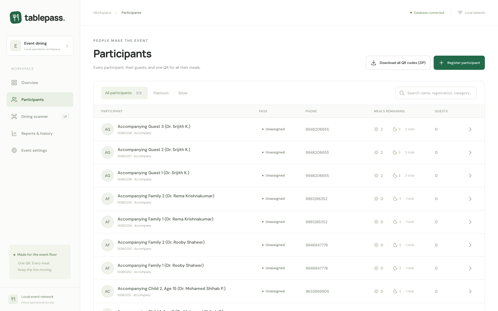
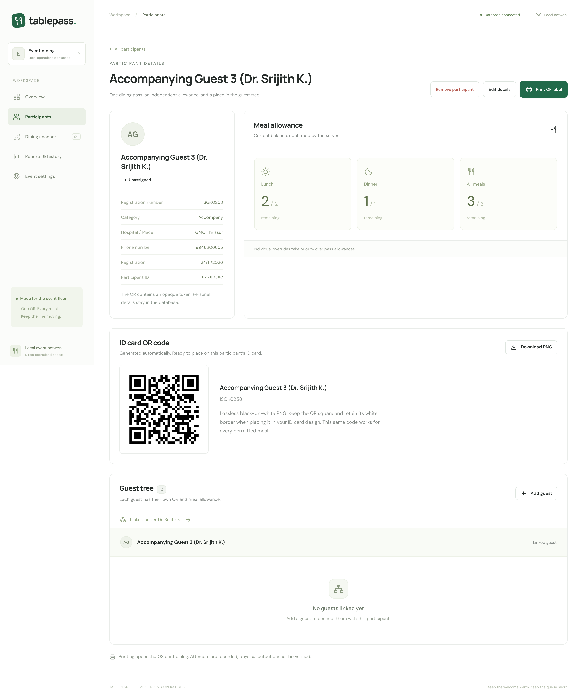
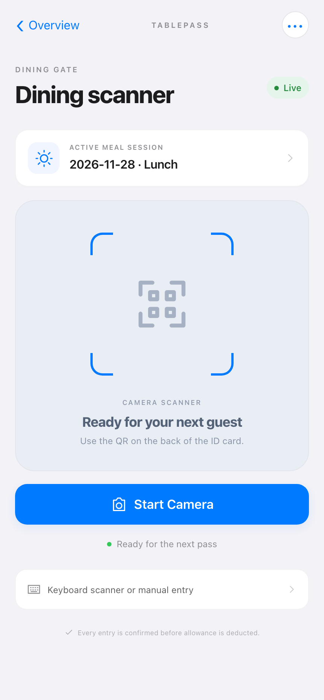
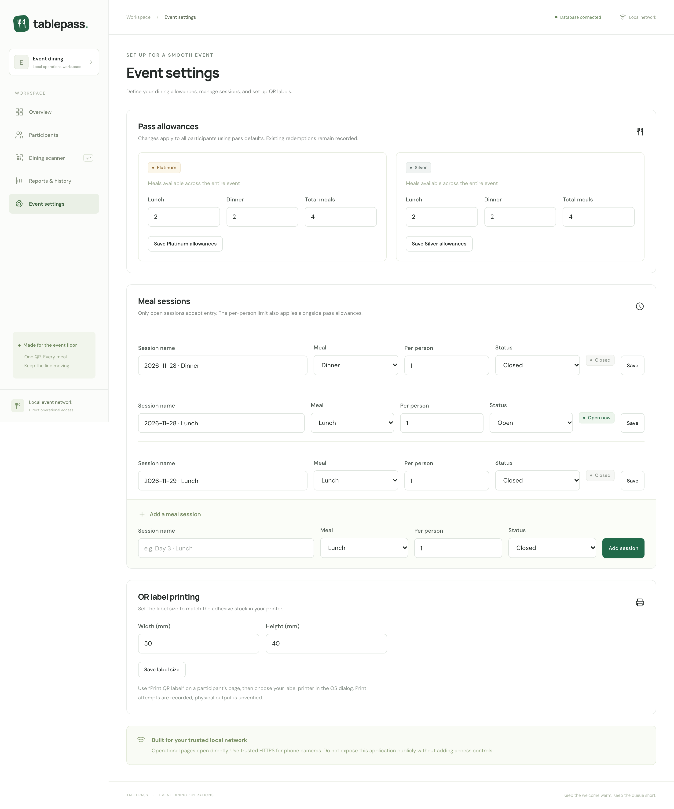
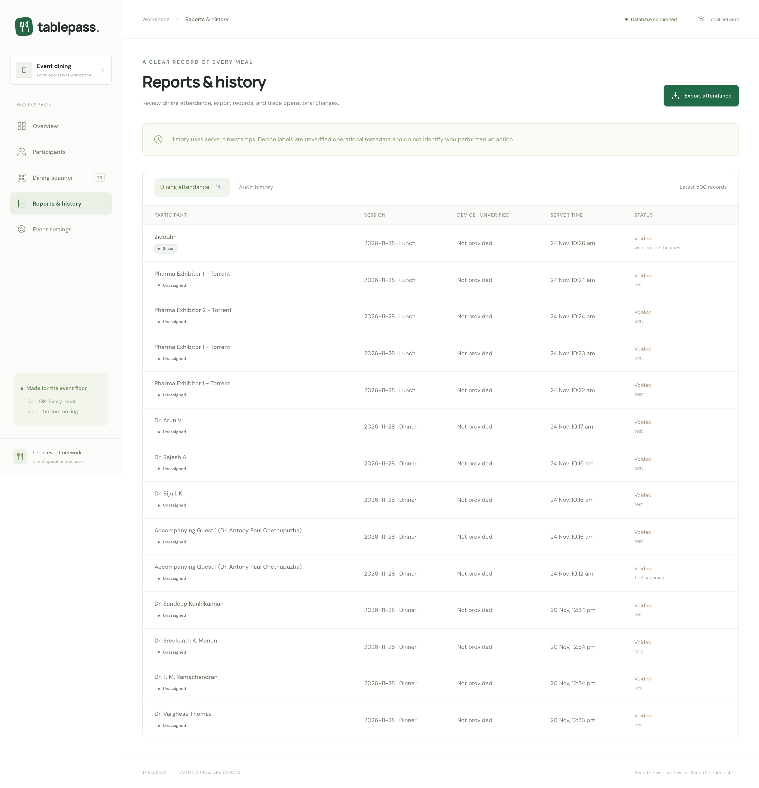

# Tablepass — Event Dining Operations

**One QR. Every meal. Keep the line moving.**

Tablepass is a local-network dining check-in system for multi-day events. Each registered participant (and each of their guests) gets a single opaque QR code on their ID card. Dining gate staff scan it with a phone camera — or a handheld keyboard scanner — and the server confirms, in one atomic transaction, whether that person is entitled to the meal being served right now.

It is built for conferences, conventions, and catered events where hundreds of people move through a dining hall and every meal has to be accounted for: no paper meal tickets, no shared spreadsheets at the door, no double-served plates.

## Table of Contents

- [Who This Is For](#who-this-is-for)
- [What Makes It Different](#what-makes-it-different)
- [Screenshots](#screenshots)
- [How It Works — The Workflow](#how-it-works--the-workflow)
- [Every Page](#every-page)
- [Tech Stack](#tech-stack)
- [Architecture](#architecture)
- [Getting Started](#getting-started)
- [Phone Scanning Over Local Wi-Fi](#phone-scanning-over-local-wi-fi)
- [Data Import & Reconciliation](#data-import--reconciliation)
- [ID Card QR Artwork](#id-card-qr-artwork)
- [Environment Variables](#environment-variables)
- [Available Scripts](#available-scripts)
- [API Reference](#api-reference)
- [Database Schema](#database-schema)
- [Testing](#testing)
- [Production Deployment](#production-deployment)
- [Safety, Durability & Privacy](#safety-durability--privacy)
- [Troubleshooting](#troubleshooting)

---

## Who This Is For

| Role | How Tablepass helps |
| --- | --- |
| **Event organizers** | Import the registration list (Excel/CSV/PostgreSQL), define meal entitlements per person, print QR ID cards, and get live meal headcounts before and during service. |
| **Dining gate staff** | A phone becomes a dedicated scanner. Point the camera at a badge, get a loud, unambiguous *approved / denied* answer in about a second — with the name, pass type, and remaining meals on screen. |
| **Registration desk** | Walk-up registrations, guest linking (families, accompanying persons), per-person allowance overrides, and QR label printing on the spot. |
| **Operations / catering leads** | Session-by-session headcounts ("293 people hold a 28 Nov dinner entitlement, 0 served, 293 yet to arrive"), attendance exports to CSV, and a full audit trail of every meal, void, and settings change. |
| **IT / venue staff** | One laptop is the whole stack. No cloud account, no database server, no Docker — just Node.js and a SQLite file on trusted local Wi-Fi. |

It is designed for a **trusted local event network**: all operational pages open directly without staff logins. Do not expose it to the public internet without adding access controls first (see [Safety](#safety-durability--privacy)).

## What Makes It Different

Most "QR check-in" tools are generic attendance apps or require SaaS accounts, per-scan fees, and internet at the venue. Tablepass is different in ways that matter on a dining floor:

- **Fully local.** The database is a SQLite file on the operator's laptop using Node's built-in `node:sqlite` driver. Nothing leaves the venue network. Works with zero internet.
- **Server-confirmed entry, always.** The camera can decode offline, but a meal is *never* counted as served until the server commits it inside a `BEGIN IMMEDIATE` transaction. Approval pop-ups only appear after server confirmation.
- **Idempotent scanning.** Every scan carries a UUID request ID. If Wi-Fi drops mid-scan, the saved request is retried with the *same* ID — the server returns the original result instead of double-counting the meal. Conflicting reuse of an ID is rejected with `409`.
- **Crash-safe under contention.** A connection lease serializes writers; session/type/total allowance checks and the deduction commit or roll back together. Two gates scanning the same badge at the same instant cannot both succeed past a limit.
- **Entitlements, not just counts.** Imported registrations carry per-person, per-session meal flags — so "this person has lunch day 1 and dinner day 1 but not lunch day 2" is enforced at the gate, not at a spreadsheet.
- **Honest audit trail.** Every redemption, void (with mandatory reason), allowance change, registration edit, removal, and print attempt is logged with a server timestamp. Device labels are explicitly recorded as *unverified metadata*, not staff identity.
- **Guests are first-class.** Accompanying persons get their own QR and their own allowance — not a "+1" scribbled on a badge.

## Screenshots

### Overview — the event at a glance
Live headcounts per meal session (expected / served / yet to arrive), session status, recent check-ins, and pass breakdown.



### Participants — registration and directory
Search, pass filters, remaining meals per person, linked-guest counts, bulk QR ZIP export, and walk-up registration.



### Participant details — one pass, one tree
Allowance balance, auto-generated ID-card QR (preview + PNG download + label print), and the guest tree for linked accompanying persons.



### Dining scanner — the phone gate
A standalone iOS-style layout: active meal session picker, camera viewfinder, one-second result pop-ups, sound cues, and a persistent retry card when a scan can't be confirmed.



### Event settings — allowances, sessions, labels
Per-pass meal limits, session open/close with per-person limits, and QR label dimensions for the OS print dialog.



### Reports & history — attendance, voids, audit
Every confirmed entry with server time, voided entries with their reasons, the audit log, and one-click CSV export.



## How It Works — The Workflow

### Before the event (organizer)

```text
Import registration list ──► Reconcile final CSVs ──► Export QR ZIP ──► Print ID cards
 (Excel / Postgres / CSV)    (db:check-final →        (qr:export or       (each person +
                              db:sync-final)          Participants UI)    each guest)
                                          │
                                          ▼
                              Set pass allowances & meal sessions in Settings
```

### During the event (two parallel tracks)

```text
REGISTRATION DESK                          DINING GATE (phone or kiosk)
─────────────────────                      ────────────────────────────
Register walk-ups                          Open /scan over HTTPS
Link guests to a primary                   Pick the active meal session
Print QR labels                            Start Camera (or keyboard scanner)
                                           Show badge → 1s popup:
                                             ✓ Approved — name, pass, meals left
                                             ✗ Denied — reason shown
                                           Connection drops → scan saved,
                                           same-request retry until confirmed
```

### Inside one scan (request lifecycle)

```text
Camera/keyboard decode
   │  token (opaque, e.g. evt_…)
   ▼
ScanGate: suppress repeats (<5s) & block while another scan is in flight
   ▼
Save {requestId, qrToken, sessionId} to localStorage  ◄── survives reload
   ▼
POST /api/redemptions
   ▼
Server transaction (BEGIN IMMEDIATE):
   1. requestId seen before? → return stored result (idempotent replay)
   2. Session exists & open & not archived?
   3. QR token maps to an active participant?
   4. Imported person? → eligibility flag for THIS session must be set
   5. Per-person session limit not reached? (no double-serving)
   6. Total & meal-type allowances remaining?
   ▼
INSERT redemption + audit row + stored result ── COMMIT together
   ▼
Popup (1s): approved ✓ / denied ✗ + remaining meals · audible beep
   ▼
Network failure? request stays pending, blocks new scans, "Retry same scan"
```

### After the event

- Export `dining-attendance.csv` from Reports (all records, not just the visible 500).
- Audit trail answers "who ate what, when, at which gate label" — timestamps are generated by SQLite on the server.
- Stop the backend cleanly and copy `data/events.db` plus any `-wal`/`-shm` files for the archive backup.

## Every Page

| Route | Name in nav | What it does |
| --- | --- | --- |
| `/` | **Overview** | Headline stats (participants, guests, meals served, lunch/dinner splits), per-session meal headcounts from imported entitlements, session status board, recent check-ins, Platinum/Silver pass breakdown, and the **Manual dinner check-in** dialog (search by name/phone/registration → confirm; same server protections as a camera scan, recorded with `entryMethod: manual`). |
| `/participants` | **Participants** | Full directory with search (name, registration number, category) and pass filter tabs. **Register participant** opens the registration form (also deep-linkable via `?register=1`). **Download all QR codes (ZIP)** exports every active participant's PNG + mapping CSV + printing instructions. |
| `/participants/:id` | Participant details | Profile card (registration number, category, hospital/place, phone), meal allowance balance with per-person overrides, auto-generated QR PNG (preview + download), **Print QR label** (records a print attempt, then opens the OS print dialog at configured label size), guest tree with **Add guest**, edit details, and **Remove participant** (reason required; soft-delete keeps history, detaches guests, disables the QR). |
| `/scan` | **Dining scanner** | Standalone iOS-style page (no sidebar) built for phones: remembered device session selection, prominent active-meal card, explicit **Start Camera** (ZXing continuous decode, rear camera), handheld-keyboard capture anywhere on the page, manual token entry, audible approve/deny tones, 1-second result pop-ups with remaining balances, a "last result" strip, open-session shortcut, and a persistent retry card for unconfirmed requests. Options menu: device label + sound toggle. |
| `/settings` | **Event settings** | Per-pass lunch/dinner/total allowances (Platinum, Silver), meal-session create/edit (name, meal type, open/closed, per-person limit; a used session can't change meal type), and QR label print dimensions (mm). Every change is audited. |
| `/reports` | **Reports & history** | Two tabs — *Dining attendance* (latest 500 entries: participant, session, unverified device label, server time, status; **Void** action with mandatory reason restores the allowance) and *Audit history* (registrations, edits, session/allowance changes, removals, print attempts). **Export attendance** downloads the full CSV. |

## Tech Stack

| Layer | Technology |
| --- | --- |
| Language | TypeScript end-to-end (strict mode), executed directly by Node — no server build step needed for TS in dev or prod |
| Frontend | React 19, react-router-style path matching, hand-rolled polling data layer (`useData`), plain CSS design system (`App.css`) |
| QR | `qrcode` (PNG/SVG generation server-side), `@zxing/browser` (camera decoding, served from the server to the scan page) |
| Backend | `node:http` server — no Express; ~90-line router with origin checks, security headers, JSON body limits, static file serving |
| Database | SQLite via **`node:sqlite` (DatabaseSync)** — WAL mode, `synchronous=FULL`, foreign keys, 5s busy timeout, single-connection lease |
| Icons | `lucide-react` |
| Validation | Hand-rolled server-side validators (`server/validation.ts`) + `zod` available; all writes are parameterized |
| Testing | `node --test` for unit/API/database suites, Playwright for browser E2E |
| Tooling | Vite 8 (dev server + `/api` proxy + optional LAN HTTPS), ESLint 10, tsx |
| Optional | `pg` only for the one-time PostgreSQL importer; `compose.yaml` spins up that legacy source if needed; `Caddyfile` for trusted LAN HTTPS in production |

Requires **Node ≥ 22.18** (Node 24 recommended) — `node:sqlite` and native TypeScript execution are built in.

## Architecture

```text
┌──────────────────────────────────────────────────────────────┐
│  Browsers (ops laptop)          Phones (dining gates)        │
│  React SPA · :5173 (Vite dev)   /scan over trusted HTTPS     │
└──────────────┬───────────────────────────┬───────────────────┘
               │ /api proxy (dev)          │ /api direct
               ▼                           ▼
┌──────────────────────────────────────────────────────────────┐
│  node:http server  (server/app.ts, :3001 or PORT)            │
│  origin allowlist · nosniff/frame/referrer headers · 32KB    │
│  JSON cap · static dist/ + SPA fallback · zxing vendor file  │
└──────────────────────────────┬───────────────────────────────┘
                               ▼
┌──────────────────────────────────────────────────────────────┐
│  operations.ts — participants, sessions, redeem, void, audit │
│  db.ts — connection lease → transaction(BEGIN IMMEDIATE)     │
│  qr.ts — PNG render/cache, ZIP export                        │
└──────────────────────────────┬───────────────────────────────┘
                               ▼
                     data/events.db (SQLite, WAL)
```

### Directory structure

```text
├── src/                    # React frontend
│   ├── pages/              # Dashboard, Participants, Participant, Scan, Settings, Reports
│   ├── components/         # ParticipantForm, ManualDinnerCheckIn, RemoveParticipant,
│   │                       # QrExportButton, UI primitives, Icon
│   └── lib/                # api client, useData polling, scanning gate logic, device storage
├── server/                 # node:http backend (plain .ts, run by Node directly)
│   ├── index.ts            # entry: open DB → migrate → listen
│   ├── app.ts              # router + security headers + static/SPA serving
│   ├── operations.ts       # all business logic (single source of truth)
│   ├── db.ts               # node:sqlite wrapper, connection lease, transactions, migrations
│   ├── qr.ts               # QR PNG ensure/cache + hand-rolled ZIP writer
│   ├── validation.ts       # request parsing/validation helpers, HttpError
│   ├── schema.sql          # tables, constraints, seeds
│   ├── import-*.ts         # one-time importers (postgres, excel)
│   ├── reconcile-final.ts  # final-CSV reconciliation engine
│   ├── export-qr.ts        # CLI QR ZIP export
│   └── sql/                # reusable cross-check SQL
├── shared/types.ts         # types shared between frontend and backend
├── scripts/                # network.mjs, setup-https.mjs, python CSV/XLSX readers
├── tests/                  # node --test suites + tests/browser Playwright specs
├── docs/                   # spec.md, screenshots/
├── imports/                # drop zone for category CSVs / final list (gitignored)
├── exports/                # generated QR ZIPs (gitignored)
├── data/                   # events.db + backups/ (gitignored)
├── scripts-dev.mjs         # dev orchestrator (backend --watch + Vite, LAN origins, --https)
├── vite.config.ts          # dev proxy, port validation, HTTPS cert wiring, fs deny list
└── Caddyfile               # optional trusted HTTPS front for production
```

### Concurrency & data-integrity model

- **Single writer, serialized.** `db.ts` hands out the one SQLite connection through a promise-chain lease. A transaction holds the lease until commit/rollback — another request can never interleave into it.
- **`BEGIN IMMEDIATE`** acquires the SQLite writer *before* eligibility/limit checks, so concurrent gates can't both pass the same check.
- **Atomic deduction.** Redemption insert, audit insert, and the stored idempotent result commit as one unit.
- **Idempotency by design.** `scan_requests` is keyed by client UUID: replays return the stored result; a reused ID with a different payload is `409`.
- **Soft deletes.** `removed_at` preserves attendance and audit history while disabling the QR and excluding the person everywhere operational.
- **Voids restore capacity.** A voided redemption no longer counts toward session/type/total limits; the reason is mandatory and retained.

## Getting Started

### Prerequisites

- **Node.js ≥ 22.18** (Node 24 recommended) — provides `node:sqlite` and native TS execution
- npm (bundled with Node)
- No database server, Docker, or credentials needed — SQLite is embedded

### Run it

```sh
git clone <your-repo-url> events-qr
cd events-qr
npm install
npm run dev
```

Open **http://localhost:5173**.

On first start the backend:

1. Creates `data/events.db` and applies `server/schema.sql`
2. Seeds **Platinum** and **Silver** passes (2 lunches + 2 dinners + 4 total meals each)
3. Seeds three closed meal sessions: `2026-11-28 · Lunch`, `2026-11-28 · Dinner`, `2026-11-29 · Lunch` (idempotent — legacy `Day N` names are renamed/merged automatically)

Then: **Settings → open a meal session**, **Participants → Register participant**, and **/scan** to start checking passes.

`npm run dev` runs `scripts-dev.mjs`, which spawns the backend with `--watch` (auto-restart) and Vite with the LAN origins added to `ALLOWED_ORIGINS` automatically.

### Environment setup

```sh
cp .env.example .env   # optional — all values have defaults
```

`SQLITE_PATH` defaults to `data/events.db` (relative to the project). A stray `DATABASE_URL` is ignored during normal startup — it's only read by the one-time importer.

## Phone Scanning Over Local Wi-Fi

Phone cameras require a **secure context** — plain `http://192.168.x.x` cannot open the camera. Tablepass generates a local CA so the gate phones get real HTTPS:

```sh
npm run dev:lan
```

This creates `.certs/` (via `scripts/setup-https.mjs`), starts everything over HTTPS, and prints the phone URL, e.g. `https://192.168.1.4:5173/scan`.

**Setup on each gate phone:**

1. Connect phone and laptop to the same Wi-Fi (client isolation must be **off**; allow Node through the laptop firewall on port 5173).
2. Transfer **only** `.certs/local-ca.crt` to the phone — *never* the `.pem`/`.key` files.
   - **iPhone:** install the profile, then Settings → General → About → Certificate Trust Settings → enable full trust for *Tablepass Local Event CA*.
   - **Android:** Security → Encryption & credentials → Install a certificate → CA certificate (names vary).
3. Open the printed HTTPS URL directly in Safari/Chrome (not an in-app browser).
4. **Start Camera** → allow access → hold the badge QR in the frame.

Restart `npm run dev:lan` if the laptop's IP changes. The phone only talks to the frontend port; only the backend touches SQLite — there are no database credentials on mobile.

## Data Import & Reconciliation

### One-time PostgreSQL import

Switching to SQLite doesn't copy old data automatically. To preserve participants, QR tokens, redemptions, and audit history:

```sh
# stop writes to the old app, set DATABASE_URL in .env, point SQLITE_PATH at a fresh file
npm run db:import-postgres
```

The import reads a read-only PostgreSQL snapshot and writes in a single SQLite transaction; it refuses to overwrite existing operational data. Keep the old database until the import is verified. `pg` is retained solely for this importer; `compose.yaml` can spin up a compatible source for local runs.

### Final registration CSVs (authoritative list)

Drop the six category exports plus `Summary-Table 1.csv` into `imports/final/`:

```text
imports/final/
├── Accompany-Table 1.csv        ├── Delegates-Table 1.csv
├── Faculties-Table 1.csv        ├── Organising Committee-Table 1.csv
├── Pharma Exhibitors-Table 1.csv├── Residents-Table 1.csv
└── Summary-Table 1.csv
```

```sh
npm run db:check-final   # dry run → imports/final/comparison.json (private)
npm run db:sync-final    # apply; auto-backs-up SQLite to data/backups/ first
```

The parser validates headers, unique registrations, all meal flags, category totals, and the grand total. **Identity matching is by name**, disambiguated by phone/hospital evidence — registration numbers alone are never trusted as identity (the final directory reassigns them). Ambiguous matches halt the update. Existing IDs, QR tokens, stored QR images, and redemptions are preserved; new people get new QRs; meal entitlements and allowance overrides follow the final flags; people absent from the final list are soft-removed; manual registrations are untouched.

Each reconciliation runs in one transaction with FK validation and is a no-op when reapplied. Verify with the reusable `server/sql/final-list-cross-check.sql` — a clean result is zero mismatched registrations and zero active imported registrations outside the final list. Private outputs land in `imports/final/{applied-summary,verification,comparison}.json`.

**After reconciling, regenerate the QR export** so new participants and filename mappings are included. Already-printed QR artwork keeps working — tokens never change.

## ID Card QR Artwork

- Registration auto-generates a **lossless black-on-white PNG** (EC level M, 24× scale) stored in `participant_qr_images`, keyed to the participant's immutable opaque token (`evt_…`). Profile or allowance edits never invalidate a printed card.
- **Per person:** the details page shows the preview, a **Download PNG** action, and the label-print action.
- **Bulk:** *Participants → Download all QR codes (ZIP)*, or `npm run qr:export` → `exports/tablepass-id-card-qr-codes.zip`. The pack contains `qr-codes/*.png`, `participants.csv` (image ↔ registration number, name, category, participant ID, parent ID; phone numbers deliberately excluded for the printer handoff), and printing instructions. Filenames embed unique IDs so repeated names can't collide. Exports cover **all** active participants, not just the current search.
- Keep the ZIP private — its codes grant dining admission.

## Environment Variables

All optional; defaults shown. Load via `.env` (gitignored) — see `.env.example`.

| Variable | Default | Purpose |
| --- | --- | --- |
| `SQLITE_PATH` | `data/events.db` | SQLite file location. Use a local disk, never a network share; keep it outside `public/` and `dist/`. |
| `PORT` | `3001` | Backend port. The Vite proxy reads the same value — after changing it, fully restart `npm run dev`. |
| `HOST` | `0.0.0.0` | Backend bind address. Dev script forces `127.0.0.1` for the API (Vite proxies); bind publicly only on a trusted LAN. |
| `ALLOWED_ORIGINS` | `http://localhost:5173,http://localhost:3001` | Comma-separated origins permitted to mutate via the API. Dev mode auto-adds current LAN origins; production must list the exact HTTPS origin. |
| `DATABASE_URL` | — | **Import only.** PostgreSQL source for `db:import-postgres`; ignored otherwise. |
| `POSTGRES_PASSWORD` | `change-me-local-only` | Only for the optional `compose.yaml` legacy-Postgres service. |

## Available Scripts

| Command | Description |
| --- | --- |
| `npm run dev` | Dev mode: backend (`--watch`) + Vite on :5173 with `/api` proxy and LAN origins allowed |
| `npm run dev:lan` | Same, over generated HTTPS for phone-camera scanning |
| `npm run https:setup` | Regenerate the `.certs/` local CA and server certificate |
| `npm run build` | `tsc` typecheck (app + server) + `vite build` → `dist/` |
| `npm start` | Production: serve `dist/` + API on `PORT` (default 3001) |
| `npm run db:migrate` | Explicitly initialize/migrate the SQLite database |
| `npm run db:import-postgres` | One-time PostgreSQL → SQLite migration (read-only source, single transaction) |
| `npm run db:import-excel` | Import registration workbook from `imports/` |
| `npm run db:check-final` | Dry-run reconciliation of `imports/final/` CSVs → `comparison.json` |
| `npm run db:sync-final` | Apply the reconciliation (auto-backup first) |
| `npm run qr:export` | Write `exports/tablepass-id-card-qr-codes.zip` for all active participants |
| `npm run lint` | ESLint over the repo |
| `npm test` | `node --test tests/*.test.ts` — unit, API, DB, import, reconcile, scanning, QR suites |
| `npm run test:e2e` | Playwright browser specs (`tests/browser/`) |

## API Reference

All routes are under `/api` on the backend port. Mutations require an allowed origin (`Sec-Fetch-Site`/`Origin` checked), JSON bodies are capped at 32 KB, and every response is `Cache-Control: no-store`. In production the same server also serves `dist/` with SPA fallback for the six page routes.

| Method & path | Purpose |
| --- | --- |
| `GET /api/health` | Liveness (`{connected:true}`); the UI polls it for the top-bar indicator |
| `GET /api/dashboard` | Headcounts, sessions with expected/served, recent redemptions |
| `GET /api/participants?search=` | Up to 2,000 active participants with computed allowances |
| `POST /api/participants` | Register (name, phone, passId, optional parentId + overrides); generates QR |
| `GET /api/participants/:id` | One participant with remaining allowances |
| `PUT /api/participants/:id` | Edit profile/allowances (parent links are immutable) |
| `DELETE /api/participants/:id` | Soft-remove; `{reason}` required; detaches guests |
| `GET /api/participants/:id/family` | Guest tree (recursive descendants + parent) |
| `GET /api/participants/:id/qr.png` | Cached PNG of the ID-card QR (`?download` for attachment) |
| `POST /api/participants/:id/print` | Audit a print attempt; returns SVG label + print settings |
| `GET /api/passes` · `PUT /api/passes/{platinum\|silver}` | Pass allowance read/update |
| `GET /api/sessions` · `POST /api/sessions` · `PUT /api/sessions/:id` | Meal sessions (open/closed, per-person limit) |
| `POST /api/redemptions` | **The scan endpoint** — idempotent, atomic eligibility check + deduction |
| `GET /api/redemptions` | Latest 500 redemptions |
| `POST /api/redemptions/:id/void` | Void an entry; `{reason}` required; restores capacity |
| `POST /api/dinner-check-in` | Manual dinner entry by participant ID (audited as `manual`) |
| `GET /api/audit` | Latest 500 audit events |
| `GET /api/printing` · `PUT /api/printing` | QR label dimensions (30–150 × 25–200 mm) |
| `GET /api/export` | Full attendance CSV (`dining-attendance.csv`, BOM-prefixed) |
| `POST /api/qr-export` | ZIP of all QR PNGs + mapping CSV + instructions |

## Database Schema

```text
passes ───────────────────────────── pass defaults (lunch/dinner/total limits)
  id ('platinum'|'silver'|'registered') · name · lunch_limit · dinner_limit · total_limit

participants ─────────────────────── people & guests
  id (uuid) · name · phone · pass_id → passes · parent_id → participants (self-FK)
  qr_token (unique, opaque 'evt_…') · lunch/dinner/total_override (nullable)
  registration_number · category · hospital · food_requirement · source_import
  removed_at (soft delete) · created_at (server time)

meal_sessions ────────────────────── what's being served
  id · name · meal_type ('lunch'|'dinner') · status ('open'|'closed')
  per_person_limit · archived · created_at

redemptions ──────────────────────── meals actually served
  id · request_id (unique, client UUID) · participant_id · session_id · meal_type
  device_label (unverified) · created_at (server time)
  voided_at · void_reason (CHECK: void requires a non-empty reason)

scan_requests ────────────────────── idempotency ledger
  request_id (PK) · qr_token · session_id · result (JSON) · created_at

participant_meal_eligibility ─────── per-person, per-session entitlement flags
  participant_id · session_id · eligible (0|1)   PK(participant, session)

audit_events ─────────────────────── operational history
  id · action · entity_id · device_label · details (JSON) · created_at

participant_qr_images ────────────── cached ID-card PNGs
print_settings ───────────────────── single-row label size (mm)
registration_imports / final_registration_stage ── import & reconcile bookkeeping
```

## Testing

```sh
npm run lint        # ESLint
npm run build       # typecheck + production build
npm test            # node --test suites (no external DB needed — temp/memory SQLite)
npm run test:e2e    # Playwright browser specs (needs npx playwright install chromium)
```

Suite coverage: API workflow, dashboard meal math, database/transaction behavior, session lifecycle, Excel import, final-CSV reconciliation, participant actions, proxy config, QR export, the client-side scan gate, validation, and SQLite pragmas — plus browser specs for direct route access.

Still needs venue verification before the real event: actual phone cameras over the LAN HTTPS setup, sound, scan throughput, and physical label printing.

## Production Deployment

```sh
npm run build
npm start          # serves dist/ + API on PORT (default 3001)
```

- Bind to the LAN (`HOST=0.0.0.0`) and set `ALLOWED_ORIGINS` to the exact HTTPS origin.
- For trusted HTTPS at a friendly name, use the included `Caddyfile` (`tls internal`) and trust Caddy's CA on each gate phone.
- **Do not expose publicly.** Operational routes have no authentication by design — it's built for a trusted event network. Public exposure requires adding access control first.
- **Backups:** stop the backend cleanly, then copy `events.db` together with any `-wal`/`-shm` files. Keep backups off the laptop and test a restore before the event.

## Safety, Durability & Privacy

- WAL journal, `synchronous=FULL`, foreign keys, parameterized statements only, 5s busy timeout.
- Pending scans are persisted in the browser **before** sending and recovered after reload; unconfirmed outcomes block further scanning until retried — a gate can never silently drop or double-count a meal.
- Approval is shown only after server confirmation; camera decoding keeps running between detections, with repeated detections suppressed.
- Audit timestamps come from SQLite on the server. Device labels are **unverified metadata**, not staff identity.
- Printing records an attempt before the OS print dialog opens — physical output is unverifiable; unattended printing would need a private server-side printer integration.
- Removed participants keep their attendance/audit history; their QR stops working immediately.
- QR tokens are opaque — no personal data is encoded in the badge itself.
- Never put `events.db` or the QR ZIP export anywhere public; both effectively grant dining admission.

## Troubleshooting

**`ECONNREFUSED` in the browser / "Backend or database unavailable"**
No backend is listening at the proxy target. Check the backend's startup line for its real port — the Vite proxy uses `PORT` from `.env` (default 3001). After changing `PORT`, Ctrl+C and restart `npm run dev` / `dev:lan` fully.

**Phone camera won't start**
Almost always a secure-context issue: open the printed `https://…:5173/scan` URL (not the laptop's `localhost`, and not plain HTTP on the LAN IP), confirm `.certs/local-ca.crt` is installed *and* fully trusted, use Safari/Chrome directly rather than an in-app browser, and allow camera permission for the site and the browser app.

**Phone can't reach the laptop**
Same Wi-Fi, AP/client isolation disabled, laptop firewall allows Node on 5173. Restart `npm run dev:lan` if the laptop got a new IP — the certificate is pinned to the addresses at generation time.

**"This meal is not included in the registration"**
The person was imported and `participant_meal_eligibility` says this session isn't on their list — that's the entitlement system working. Re-check the final CSV flags or add an allowance override if it should be included.

**"Already served in this session"**
The per-person session limit was reached (default 1). If it was a mistake, void the entry in **Reports → Dining attendance** — the allowance is restored.

**Scan stuck on "Entry not confirmed"**
A request was saved but never confirmed. Use **Retry same scan** on the persistent card — it resubmits the *same* request ID, so a flaky connection can't double-count. This blocks new scans on purpose until resolved.

**Restoring a backup / moving machines**
Stop the backend first, then copy `events.db` **with** `events.db-wal` and `events.db-shm` if present. Never run the file from a network share.

**`Vite … Build failed` / stale modules**
`rm -rf node_modules/.vite && npm install`, then restart dev.

---

*Keep the welcome warm. Keep the queue short.*
